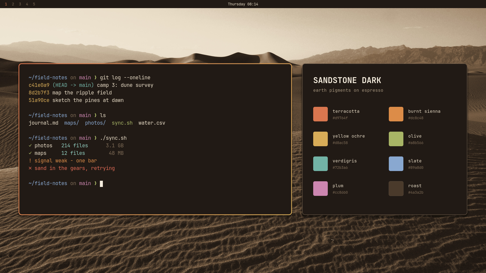
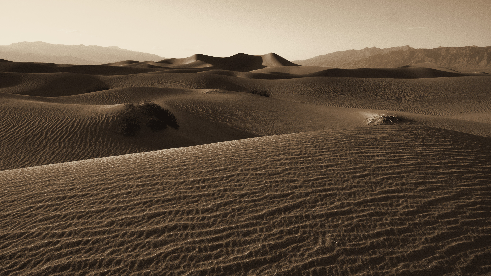
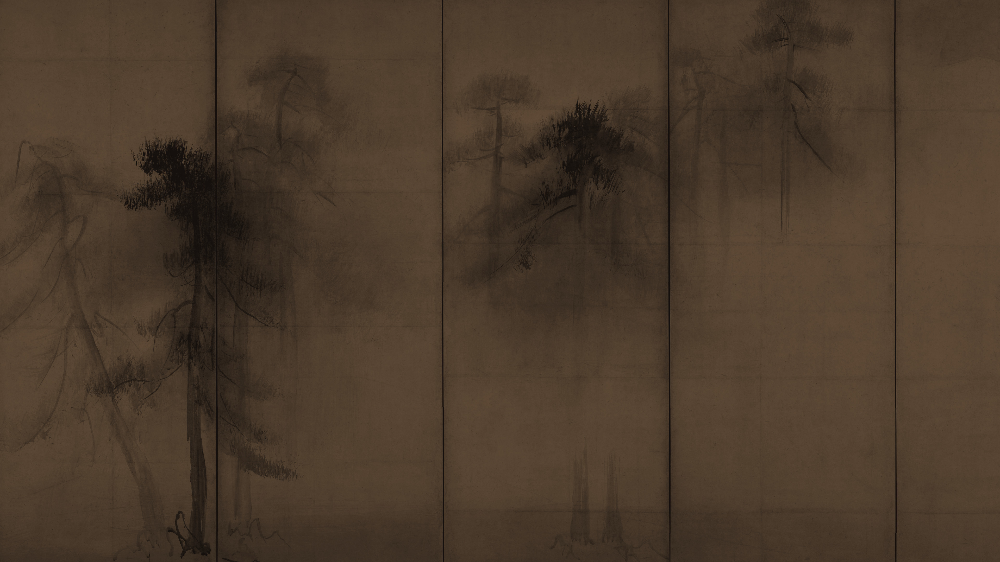
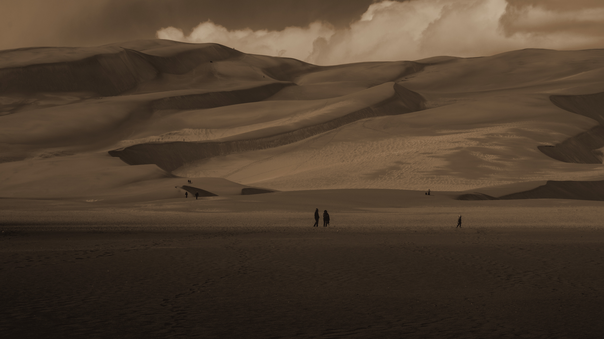
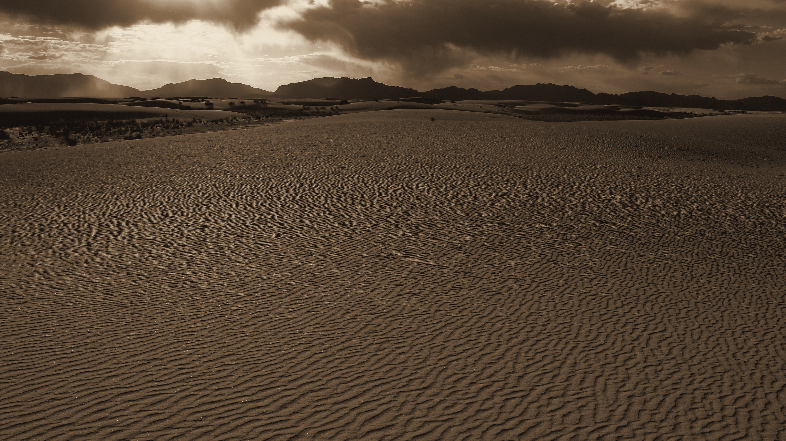

# Sandstone Dark for Omarchy

A dark [Omarchy](https://omarchy.org) theme: warm beige text on an espresso background, with earth-pigment accents (terracotta, burnt sienna, yellow ochre, olive, verdigris, slate, plum and umber). It comes with four wallpapers, desert dunes at dusk and a 16th-century ink painting, all toned into the same palette.



## Install

```bash
omarchy theme install https://github.com/YassineSawahi/omarchy-sandstone-dark-theme
```

Cycle the wallpapers with `omarchy theme bg next`.

## Wallpapers

| | |
|---|---|
|  |  |
|  |  |

Each one is a public-domain image cropped to 3840×2160 and run through a gradient map built from the theme's own colours (darkest roast → espresso → umber → beige → cream). That way the wallpapers sit inside the palette instead of next to it.

| File | Source |
|---|---|
| `1-death-valley` | [Mesquite Flat Sand Dunes, Death Valley National Park](https://commons.wikimedia.org/wiki/File:Death_Valley_National_Park_(29911042692).jpg). NPS photo by D. Pate, public domain |
| `2-pines` | [Hasegawa Tōhaku, *Pine Trees*](https://commons.wikimedia.org/wiki/File:Hasegawa_Tohaku,_Pine_Trees_-_low_resolution.jpg), 16th century, Tokyo National Museum. Public domain |
| `3-great-sand-dunes` | [Great Sand Dunes National Park and Preserve](https://commons.wikimedia.org/wiki/File:Great_Sand_Dunes_National_Park_and_Preserve_(32382686824).jpg). NPS photo by M. Reed, public domain |
| `4-white-sands` | [Ripples in the sand, White Sands National Park](https://commons.wikimedia.org/wiki/File:Ripples_in_the_sand_(fea4a9f4-155d-451f-677f-79d82b5e112e).JPG). NPS photo, public domain |

## Palette

Every normal colour reads at 4.5:1 or better against the background and every bright one at 3:1 or better. Most clear those by a wide margin.

| Slot | Pigment | Value | Contrast |
|---|---|---|---|
| background | espresso | `#211a15` | |
| foreground | beige | `#e8dcc6` | 12.66 |
| accent | terracotta | `#d9764f` | 5.44 |
| red | brick | `#e06a55` | 5.20 |
| orange | burnt sienna | `#dc8c48` | 6.45 |
| yellow | yellow ochre | `#d8ac58` | 8.14 |
| green | olive | `#a8b566` | 7.74 |
| cyan | verdigris | `#72b3a6` | 7.12 |
| blue | slate | `#89a8d0` | 7.01 |
| magenta | plum | `#cc86b0` | 6.22 |
| brown | umber | `#b28b64` | 5.53 |
| muted | warm taupe | `#7d6a55` | 3.32 |
| selection | roast | `#4a3a2b` | text on it 8.0 |

Focused windows get a terracotta-to-ochre border. Icons are `Yaru-wartybrown`.

## How it works

This repo is only files: a palette, four wallpapers and a few images. Omarchy does the rest, on your PC. Nothing runs and nothing goes over the network once it's cloned.

- `omarchy theme install` clones the repo into `~/.config/omarchy/themes/sandstone-dark` and switches to it.
- Switching copies the theme into `~/.local/state/omarchy/current/theme` and renders every app's config (terminals, Hyprland, Neovim, btop, VS Code, the bar) from `colors.toml` through Omarchy's own templates. The theme ships no app configs of its own.
- `icons.theme` names the icon theme, `Yaru-wartybrown`, which Omarchy sets for GTK apps.
- `backgrounds/` holds the wallpapers. `omarchy theme bg next` cycles through them.
- `preview.png` is what Omarchy's theme picker shows.
- `unlock.png` is the logo for the boot screen where you type your disk password, and `preview-unlock.png` its preview. They're only used if you pick Sandstone Dark under Omarchy menu → Appearance → Unlock, which asks for your password because the boot screen is system-wide.

## License

The theme (colours, previews, toned wallpapers) is released under the MIT license. The wallpapers are derived from public-domain works, credited above.
